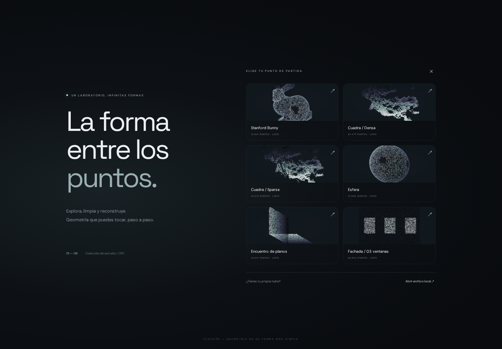
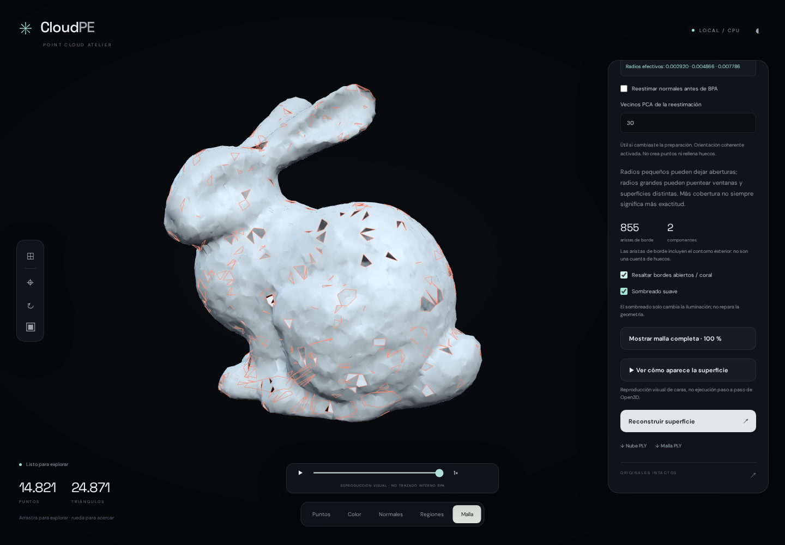

# CloudPE

### Un laboratorio visual de procesamiento de nubes de puntos, en CPU.

**CloudPE** permite explorar una nube 3D, limpiar ruido, estimar normales mediante PCA, segmentar superficies y reconstruir una malla con **Ball Pivoting**. La aplicación funciona localmente y combina un visor WebGL inmersivo con un núcleo científico en Python.

Proyecto académico de **Point Cloud Processing**: `input → normals, segmentation, mesh reconstruction`.



## Qué puedes hacer

- Explorar **seis ejemplos precalculados incluidos en el repositorio**, sin descargar datos ni recalcular algoritmos al abrirlos.
- Cargar PLY, PCD o XYZ/TXT con un conjunto de trabajo acotado.
- Limpiar coordenadas inválidas, duplicados y puntos atípicos; reducir mediante vóxeles.
- Estimar normales con una **implementación propia de PCA local** y orientarlas mediante un bosque de expansión mínimo.
- Segmentar mediante **crecimiento de regiones geométrico** o un **grafo adaptativo que combina geometría y color CIELAB**.
- Generar mallas BPA con radios personalizados, unidades relativas/absolutas y diagnóstico de bordes abiertos.
- Ver puntos, colores, normales, segmentos y superficies; descargar nubes y mallas PLY.
- Ejecutar cálculos en procesos separados y cancelarlos sin cerrar la aplicación.

El visor ocupa toda la pantalla, con controles flotantes, animación de entrada, revelado progresivo y onda radial. Los efectos visuales no alteran las coordenadas de procesamiento.

## Tecnología y arquitectura

| Capa | Tecnología | Responsabilidad |
|---|---|---|
| Visor e interfaz | JavaScript ES modules, **Three.js**, HTML/CSS | Renderizado 3D, cámara orbital, shaders y controles flotantes |
| Build frontend | **Vite**, npm | Compilación, dependencias y recursos locales |
| API local | **FastAPI + Uvicorn** | Trabajos, resultados y transferencia binaria al navegador |
| Cómputo | **Python 3.10**, NumPy, SciPy | PCA, vecindarios KD-tree, limpieza y segmentación |
| Geometría | **Open3D** | Ball Pivoting, operaciones de malla y métricas |
| Archivos | **plyfile**, lector PLY acotado propio | Atributos, muestreo y omisión de listas variables |
| Color | **scikit-image** | Conversión RGB → CIELAB |
| Pruebas | **pytest + Playwright/Chromium** | Algoritmos, workers, API y recorrido visual |

```text
Navegador / Three.js
         ↕ HTTP + buffers binarios
API FastAPI local
         ↓ un trabajo simultáneo
Proceso Python aislado → limpieza / PCA / segmentación / BPA
         ↓
.cloudpe/ → puntos, malla, parámetros e historial
```

**No requiere CUDA ni GPU NVIDIA.** Los algoritmos se ejecutan en CPU; el visor necesita un navegador con WebGL. No usa servicios externos para procesar los datos.

## Instalación

### Requisitos

- Git y **pyenv**.
- Python **3.10.18** instalado mediante pyenv.
- Node.js **22 LTS** y npm (entorno probado).
- Navegador moderno con WebGL.

En Arch Linux, instala previamente las dependencias de compilación que necesite pyenv para construir Python. No es necesario instalar paquetes Python globalmente.

```bash
git clone https://github.com/CdeCasurpie/CloudPE.git
cd CloudPE

pyenv install -s 3.10.18
PYENV_VERSION=3.10.18 pyenv exec python -m venv .venv
.venv/bin/python -m pip install -r requirements-web.txt
.venv/bin/python -m pip install -e .

cd frontend
npm ci
npm run build
cd ..

bash run_cloudpe.sh
```

Abre **http://127.0.0.1:8765**.

Para reproducir las versiones Python exactas del entorno probado, instala `requirements-lock.txt` dentro de `.venv` antes de instalar el proyecto editable. `frontend/package-lock.json` fija las dependencias npm. Las fuentes y miniaturas se sirven localmente.

## Primer recorrido

1. Elige **Stanford Bunny** o **Fachada** en la galería.
2. Explora el resultado precalculado y cambia entre puntos, color, normales, regiones y malla.
3. Selecciona una etapa del panel flotante para ejecutar de nuevo el procesamiento.
4. En **05 · Superficie**, configura radios y reconstruye con BPA.
5. Activa **bordes abiertos** para inspeccionar las aberturas, o descarga el PLY.

**−** oculta el panel; **⌖** o la tecla **F** reencuadra. La rueda acerca y aleja. El botón de movimiento permite reducir animaciones.



### Configurar Ball Pivoting

- **Radios:** de uno a seis valores positivos, separados por comas. Se ejecutan de menor a mayor.
- **Mediana:** multiplica los radios por la distancia mediana al vecino más cercano.
- **P90:** usa una referencia mayor, útil para explorar densidad irregular.
- **Unidades originales:** aplica radios absolutos en las unidades del modelo, no necesariamente metros.
- **Reestimar normales:** permite recalcularlas con un número de vecinos PCA configurable antes de BPA.

Punto de partida recomendado: **`2.5, 4, 6` × mediana**. Para comparar cobertura: **`3, 5, 8`**. Radios grandes pueden reducir aberturas, pero también unir superficies distintas o perder detalles. El panel muestra los radios efectivos, las aristas de borde y las componentes.

**Las aristas de borde no equivalen al número de huecos**: incluyen los contornos exteriores. La opción de sombreado solo cambia la iluminación, no repara la malla.

### Tus propias nubes

Usa **Abrir archivo local** e introduce su ruta. La aplicación limita el conjunto de trabajo a **10k–50k puntos**, seleccionados durante la lectura PLY; no carga primero millones de puntos para después reducirlos.

- PLY binario con registros fijos: memory mapping.
- PLY con listas variables, como observaciones de OpenMVS: recorrido secuencial sin crear millones de objetos Python.
- PCD/XYZ/TXT: solo archivos de hasta 8 MiB en el modo interactivo.
- XYZ/TXT: exactamente `X Y Z` o `X Y Z R G B` con RGB entre 0 y 255.

El muestreo pierde detalle: **no es procesamiento completo out-of-core**. Para estudiar una fachada, abre preferentemente un archivo ya recortado. La orientación del visor admite ±Y/±Z y no cambia los PLY exportados.

## Ejemplos incluidos

Los datos **sí están versionados** en [`examples/`](examples/): aproximadamente **18,3 MiB** en total. No necesitas los PLY originales de la tesis, Git LFS ni una descarga adicional para probar la galería.

| Ejemplo | Procedencia | Qué permite explorar |
|---|---|---|
| `bunny` | Stanford Bunny muestreado con ruido añadido | Superficie curva y radios BPA |
| `fachada` | Generador propio con tres ventanas retranqueadas | Ruido, planos y discontinuidades |
| `esfera` | Superficie sintética ruidosa | Normales conocidas y curvatura |
| `esquina` | Dos planos sintéticos perpendiculares | PCA y segmentación geométrica |
| `cuadra_dense` | Muestra fotogramétrica proporcionada por el autor | Geometría urbana real y ruido |
| `cuadra_sparse` | Nube dispersa fotogramétrica proporcionada por el autor | Limitaciones de cobertura y densidad |

Cada carpeta incluye `original.ply`, `processed.ply`, `mesh.ply` y `report.json`. **`original.ply` significa entrada del ejemplo distribuido**, que puede ser una muestra reducida o un dato sintético; no necesariamente la captura original completa.

Consulta [`examples/README.md`](examples/README.md) y [`THIRD_PARTY_NOTICES.md`](THIRD_PARTY_NOTICES.md) para procedencia y condiciones del Stanford Bunny.

## Pruebas y reproducción

```bash
# Pruebas Python
.venv/bin/pytest -q
.venv/bin/python scripts/verify_examples.py

# Pruebas de navegador, con CloudPE ejecutándose
cd frontend
npx playwright install chromium
npm run test:e2e
cd ..

# CLI: inspección segura y ejecución con validación
.venv/bin/cloudlab inspect examples/bunny/original.ply
.venv/bin/cloudlab run examples/bunny/original.ply --output outputs/bunny_run

# Comparar radios sobre la misma nube; actualiza mallas derivadas de la galería
.venv/bin/python scripts/review_bpa.py
```

Validación registrada: **19 pruebas Python y 4 de navegador**. Los resultados y límites experimentales están en [`RESULTADOS.md`](RESULTADOS.md).

La galería ya está generada. Para regenerar los ejemplos sintéticos y Bunny:

```bash
.venv/bin/python scripts/build_gallery.py --bunny
.venv/bin/python scripts/review_bpa.py
.venv/bin/python scripts/build_previews.py
.venv/bin/python scripts/verify_examples.py --write
```

Regenerar Bunny necesita internet la primera vez. Para regenerar también las muestras fotogramétricas a partir de tus propios originales: añade `--user-data-dir /ruta/a/las/nubes` a `build_gallery.py`; espera los nombres `cuadra-025_0-10s_dense.ply` y `cuadra-025_0-10s_sparse.ply`.

## Estructura del repositorio

```text
cloudlab/              Núcleo, CLI, API y worker aislado
frontend/              Interfaz Three.js, recursos y pruebas Playwright
examples/              Seis datasets y resultados precalculados incluidos
scripts/               Generadores, miniaturas y comparación BPA
tests/                 Pruebas Python
docs/                  Capturas y notas de desarrollo
run_cloudpe.sh         Inicia la aplicación actual
app.py / run_app.sh    Explorador Streamlit anterior, conservado como herramienta auxiliar
```

## Alcance y límites

- PCA y segmentaciones están implementadas aquí; **BPA procede de Open3D**.
- La segmentación es geométrica/cromática, **no semántica neuronal**.
- La reproducción de caras es una animación radial de la malla final, **no el trazado interno de BPA ni una esfera pivotando realmente**.
- El Bunny distribuido proviene de una malla muestreada y la fachada es sintética: no son capturas físicas de un sensor LiDAR.
- No se garantiza una malla cerrada ni correcta para cualquier nube. Datos faltantes, ruido y densidad irregular siguen importando.
- La interfaz actual no incluye recorte interactivo ni reparación Delaunay. La reparación local experimental está en el núcleo/CLI y en el explorador anterior.
- Solo un trabajo activo. Las sesiones se guardan en `.cloudpe/` y se acumulan en disco; no hay limpieza automática.
- La API permite abrir rutas locales: **mantener en localhost, no exponer a internet**.

## Créditos y condiciones

Proyecto de **CdeCasurpie**. Stanford Bunny: **Stanford University Computer Graphics Laboratory**, obtenido mediante Open3D. Sus condiciones permiten investigación y redistribución gratuita con atribución, pero restringen usos comerciales sin permiso. **Que el repositorio sea público no elimina esas condiciones.**

No se ha elegido todavía una licencia general para el código propio. Las dependencias conservan sus licencias respectivas; véase [`THIRD_PARTY_NOTICES.md`](THIRD_PARTY_NOTICES.md).
